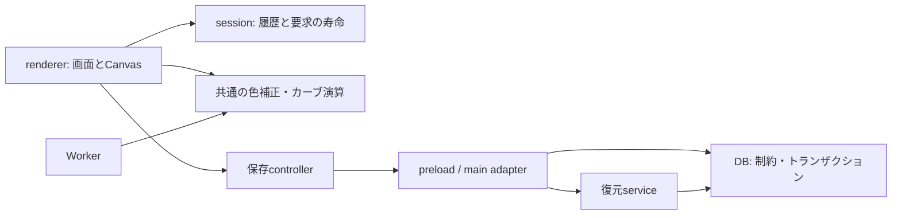

**構造改善の方針と実装記録**

目的は、リリース済み機能を維持しながら変更の影響範囲を限定すること。開始点はv2.5.3 (`3b7a73e`)。先に加えた不具合修正と回帰テストは、レタッチ・データ保全の各検証文書に記録している。

2026-09-10追記：画像素材・プレビューの競合、WebP登録寸法、検証ハーネス、配布版の確認については [継続改善の記録](C:/Users/tyusk/vrchat-world-photo-manager/docs/maintenance-progress-2026-09-10.md) を参照。以下は最初の4段階の構造改善時点の記録。

**1. 編集状態・履歴・非同期処理の責任範囲**

`photo-editor-session.js` は1回の編集画面の寿命を管理する。履歴とタイマー、非同期要求の所有者はこの部品が保持し、編集対象の値やDOMとは分離する。

- rendererが持つ編集内容：補正、切り抜き、カーブ、レイヤー、マスク、書き出し設定。
- rendererが持つ表示・操作状態：ポインター、ドラッグ、ブラシ、プレビュー、Canvasキャッシュ。
- sessionが持つ一時制御：Undo/Redo/pending履歴、確定タイマー、履歴復元中フラグ、処理要求。
- rendererが担うadapter：履歴snapshotの正規化・反映、画面更新、モデル実行、ファイル読込。

sessionにはDOM、Canvas、Electron、DBの依存がない。開始・終了・写真切替はactivate/deactivateに集約。取り消し済みのタイマーがキューに残った場合も、所有sessionとtimerの両方を確認する。AIマスクとマスク画像読込は同じ要求枠を使い、元画像読込は別枠を使う。

元コードではAの履歴タイマーがBの履歴を確定し得た。既存スモークにあった手動タイマー解除を除き、実際の開閉で保全されるテストを追加した。履歴の上限40件、420msの確定待ち、連続操作のまとめ、変更なし時のRedo保持など既存仕様は維持する。

現段階の検証：session単体14件、実rendererの競合55件、保存PNG2モードが通過。既存snapshotの全内容比較も新sessionの履歴参照へ接続し、比較対象を減らしていない。

**2. 画面に依存しない画像処理**

`photo-editor-color-core.js` に色補正・カーブの正規化、補間、LUT、RGB/HSV変換、ノイズ、RGBA画素演算を集約した。通常rendererとclassic Workerは同じ15関数の実装を利用する。Canvasの作成・合成、画面状態、Workerの要求管理はそれぞれのadapterに残す。

抽出前の2経路で19カーブ×115補正値の2,185ケースを照合し、その正規化・LUT・パラメータ・画素の期待値をfixtureに固定した。現在のコードから期待値を再生成するテストではない。共有化後も全件一致し、alphaと入力の不変を確認した。

ライブWorkerでもRGB／HSV／併用の非既定補正について、bitmapとPNG bufferの計6ケースを検証。Workerを直接呼んでレスポンスを要求し、通常rendererと全画素一致した。Worker失敗時のフォールバックだけで通過するテストにはしていない。

**3. UI・保存・DBの境界**

- `photo-editor-save.js` は保存開始時の写真情報、メタデータ、書き出し設定を固定し、描画→保存→登録反映を制御する。描画、IPC、一覧更新、UI通知は依存として渡す。
- 描画完了前に閉じた／切り替えた要求はファイル保存へ進めない。すでにIPC保存を始めた場合は、その結果をアプリの登録情報へ反映するが、新しい編集画面の閉じる・保存状態解除・エラー表示は行わない。
- rendererは操作受付・文言・Canvas描画のadapter。非同期描画の後に所有sessionを確認し、別写真を用いたフォールバックを防ぐ。
- `app-data-backup-service.js` は選択→読込→検証→復元前バックアップ→DB復元→cache無効化→設定保存という手順を保持する。Electronのdialog、ファイルI/O、DB、設定保存はindex側のadapterとして注入する。
- DBはsnapshotの妥当性とトランザクションを引き続き担い、serviceへ移して検証を省略できるようにはしない。

保存controller32件、復元service25件、既存の実復元23シナリオ・PNG保存2モードが通過。native dialogを含む配布版の確認はリリース前に別途必要。

実画面の保存競合14ケースも追加した。保存直後だけでなく、sidebar更新のawait中に別写真へ移った場合も所有者を再判定し、現在の選択月と編集状態を保つ。



**4. 測定してから最適化**

`benchmark-backup-restore.js` で5千／2万写真の合成DBを計測する。2回warmup・5回測定の中央値を取り、毎回全5テーブルの全列一致を確認。省略列の既定値、nullable列、列集合の異なる行も混在させる。計測にJSON・ファイルI/O・画像処理は含めず、DB処理の比較として扱う。

復元INSERTの準備を、毎行ではなく同じ列集合ごとに再利用するよう変更した。Mapの寿命は1テーブルの復元呼び出し内に限定し、復元をまたいで保持しない。行の値は毎回抽出し、省略列の既定値・明示null・検証・トランザクションは変更していない。

| 合成データ | 修正前中央値 | 修正後中央値 | 短縮率 |
| --- | ---: | ---: | ---: |
| 5,000写真／15,346総行 | 213.69ms | 85.41ms | 60.0% |
| 20,000写真／61,096総行 | 906.79ms | 434.50ms | 52.1% |

[修正前](C:/Users/tyusk/vrchat-world-photo-manager/out/benchmark-backup-restore/2026-09-09T13-10-55-153Z-68632/result.json) と [修正後](C:/Users/tyusk/vrchat-world-photo-manager/out/benchmark-backup-restore/2026-09-09T13-26-07-395Z-63864/result.json)。同じ環境・データ生成・測定方法で比較し、各14回の復元で全行が一致した。メモリDBの測定であり、ディスクを含むアプリ全体の復元所要時間を示すものではない。

履歴についても `benchmark-photo-editor-history.js` で測定した。1MiBの合成マスク文字列を含む履歴確定は初回約1.2ms、再実行約2.2〜2.3ms／操作。現行JSON比較のキー順や特殊値の意味を変える追加最適化は採用せず、現在の挙動を維持する判断とした。[初回](C:/Users/tyusk/vrchat-world-photo-manager/out/benchmark-photo-editor-history/2026-09-09T13-27-05-867Z-38492/result.json) ／ [再実行](C:/Users/tyusk/vrchat-world-photo-manager/out/benchmark-photo-editor-history/2026-09-09T13-28-39-762Z-65304/result.json)。実画像のエンコードやCanvas描画を含む時間ではない。

**検証コマンド**

```powershell
npm.cmd test
npm.cmd run smoke:retouch
npm.cmd run smoke:data-safety
npm.cmd run audit:i18n -- --strict
```

`npm test` はアプリを起動せず、独立部品の契約と画像計算を検証する。スモークは実renderer/Worker/main/preloadを一時環境で接続して検証する。テスト・ベンチマーク・fixtureは配布対象から除外し、実行時の新規moduleはsrcに含める。

**最終検証（2026-09-09）**

- Node単体71件、画像演算の固定期待値2,185ケースが通過。
- `smoke:retouch` 7本が一括で終了コード0。マスク競合55件、保存競合14件、実Worker6件、PNG保存2モード、座標、ブラシ、プリセットを確認。
- `smoke:data-safety` が一括で終了コード0。既存DB互換、バックアップ検証150件、実復元23件、World情報24件を確認。
- PNG各5種類×2モードとプリセット4種の画素hashが、今回の構造改善・先行不具合修正前のbaselineと一致。元画像hashも不変。
- JavaScript36ファイルの構文、翻訳監査457候補・漏れ0、差分の空白検査が通過。

最新の実行記録：

- [マスク競合](C:/Users/tyusk/vrchat-world-photo-manager/out/smoke-subject-session/worldshot-subject-session-CWVBbQ/result.json) ／ [保存競合](C:/Users/tyusk/vrchat-world-photo-manager/out/smoke-save-session/worldshot-save-session-hu5NZI/result.json) ／ [実Worker](C:/Users/tyusk/vrchat-world-photo-manager/out/smoke-worker/worldshot-worker-25xIhH/result.json)
- [保存manual](C:/Users/tyusk/vrchat-world-photo-manager/out/smoke-export/worldshot-export-b18U2z/result.json) ／ [保存legacy](C:/Users/tyusk/vrchat-world-photo-manager/out/smoke-export/worldshot-export-gpibh9/result.json)
- [座標](C:/Users/tyusk/vrchat-world-photo-manager/out/smoke-coordinate-space/20260909-222833/result.json) ／ [ブラシ](C:/Users/tyusk/vrchat-world-photo-manager/out/smoke-mask-brush/20260909-222840/result.json) ／ [プリセット](C:/Users/tyusk/vrchat-world-photo-manager/out/smoke-presets/20260909-222846/result.json)
- [実復元](C:/Users/tyusk/vrchat-world-photo-manager/out/smoke-backup-restore/worldshot-backup-restore-DIItnT/result.json)

実ONNXモデルの推論品質、全編集機能の組合せ、JPEG/WebP保存、別GPU/OSでの一致、配布パッケージ作成・インストーラ・更新配信は今回未検証。コード分離と合成入力の検証によって全不具合がなくなったと判断しない。

全面書き換え、依存関係更新、外観変更、リリースはこの構造改善に含めない。まだ残る大きなrenderer/mainの責務は、同じ方法で段階的に整理する。
