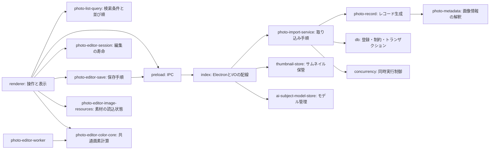

**現在のコード構成（2026-09-10）**

WorldShot Log 2.5.3を起点に、既存の操作・保存結果を保ちながら責務を分離している。この文書は現在の構成、各日付の改善記録は変更理由と検証証拠を扱う。アプリのバージョンは公開済み版から変更していない。

**処理の入口と責務**

| 部品 | 担当 | 主な依存 |
| --- | --- | --- |
| `src/index.js` | Electron起動、IPC、ダイアログ、ファイル操作の入口、各サービスへの配線 | Electron、fs、DB、各サービス |
| `src/preload.js` | rendererへ公開するIPCの窓口 | Electron |
| `src/db.js` | スキーマ互換、クエリ、保存制約、World情報の由来、バックアップ検証とトランザクション | SQLite |
| `src/renderer.js` | 画面操作、表示状態、DOM、Canvas、サービスの結果反映 | preload API、下記のブラウザー部品 |
| `src/photo-list-query.js` | 一覧の検索、並び順、お気に入り・向き・ラベルの絞り込み、ラベル件数 | 渡された写真と検索条件。DOM/IPCなし |
| `src/photo-metadata.js` | 日時・ファイル名・XMP/タグ・World情報・文字化け補正・寸法分類 | path、既存ExifReader/iconv。Electron/DB/ファイル操作なし |
| `src/photo-record.js` | 画像から保存用レコードを生成し、情報の取得元の優先順位を決める | metadata、hash、注入した読込・stat・デコード・サムネイル・時計 |
| `src/photo-import-service.js` | 前処理→登録→不足サムネイル補完→結果集計を制御 | 注入したレコード生成・DB・補完・World同期対象変換 |
| `src/concurrency.js` | 同時実行数を制限し、入力順に結果を返す | 渡された非同期関数と進捗通知 |
| `src/thumbnail-store.js` | サムネイル保管場所、旧フォルダ移行、縮小生成、欠損修復、管理範囲の検証 | 注入したfs・画像デコード・home・DB取得 |
| `src/ai-subject-model-catalog.js` | 同梱／追加モデルの定義、ハッシュ、ライセンス、公開状態 | 静的な定義のみ |
| `src/ai-subject-model-store.js` | モデル取得・ハッシュ検証・状態集計・削除 | fs・hash、注入した保管場所・fetch・フォルダ表示 |
| `src/app-data-backup-service.js` | 復元前検証・バックアップ・DB復元・設定反映の順序 | 注入したdialog/fs/DB/設定操作 |
| `src/photo-editor-session.js` | 編集の寿命、Undo/Redo、履歴タイマー、非同期要求の所有者 | snapshot取得・反映のコールバック |
| `src/photo-editor-save.js` | 保存開始時情報の固定、描画→保存→一覧反映の制御 | session、注入した描画・IPC・結果反映 |
| `src/photo-editor-image-resources.js` | マスク・画像素材の読込状態、保存に必要な素材の成功・失効判定、フォント等の任意リソースの待機上限 | 注入した画像生成・cache・再描画通知・タイマー |
| `src/photo-editor-color-core.js` | 色補正、RGB/HSVカーブ、RGBA画素の共通計算 | 数値・配列。通常rendererとWorkerで共有 |
| `src/photo-editor-worker.js` | WorkerでのCanvas処理と画像の返却 | OffscreenCanvas、color core |
| `src/photo-editor-subject-mask.js` / `src/photo-editor-image-overlay.js` | 既存のマスク・画像レイヤーの状態正規化と補助計算 | 各入力状態 |

サービスからElectronを直接読み込まず、呼び出し元が必要な処理を渡す。これによって、画像の読み込みを保留した場合やDBが失敗した場合を、実ファイルやユーザーDBを変更せずに検証できる。実際の配線は別途Electronスモークで確認する。

**維持している主な契約**

- 一覧は写真の配列と検索条件から新しい配列を返し、元配列・写真オブジェクトを変更しない。検索範囲はWorld名／メモ／プリントノート。World検索は表示名・元の名前・World IDを対象とする。
- 日付の並び順は従来の文字列解釈を維持し、同時刻ならID、さらに同順位なら日本語のファイル名順。数値の撮影timestampを新たな優先キーにはしない。
- レコードの撮影日時はファイル名→Exif→ファイル更新日時。寸法はnative decode→WebPヘッダー→ファイル名。同じ画像のhash・撮影日・メタデータを分離前と一致させる。
- 取り込みの前処理は同時実行するが、DBへ渡すレコード・失敗一覧は入力順。同じパスの重複除外、一括登録失敗時の個別再試行、既存写真・移動写真の件数計算を維持する。
- World同期対象は元画像のタグだけでなく、手動指定等を保全した登録後のDB行から作る。
- レタッチの非同期結果は、開始した編集が有効な場合だけその編集へ反映する。実行済み保存や素材追加の全体情報は反映し、新しい編集画面への干渉を避ける。

この分離で既存の特殊値の扱いや失敗挙動を一律に変更していない。仕様を変える場合は、既存の期待値を再生成して合わせるのではなく、どの契約を変更するか明示して別の変更として検証する。

**残っているまとまり**

rendererには引き続き、ギャラリーDOM・選択と画面遷移・レタッチの操作とCanvas描画が多く残る。mainにはパス復旧・World情報取得・更新機構の配線が残る。今回の確認候補では、寿命・保存・素材読込・画素計算・検索・取り込み・保管という境界を分け、操作とCanvas全体の一括移動は行わない。画面状態と座標変換を跨ぐ分離は、独立した契約を固定してから別変更で扱う。古い更新経路などの隔離されたコードは、通常経路の整理に混ぜて変更しない。

検証の入口は [保守用ハーネス](./maintenance-harness.md)、今回の分離の証拠は [一覧・取り込みの構造整理](./list-import-refactor-2026-09-10.md) を参照。
